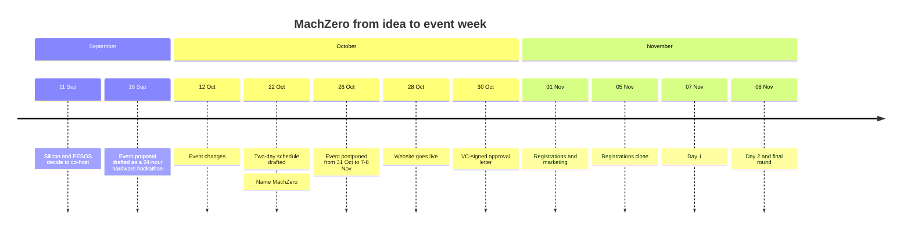

<div align="center">

#  MachZero '26

**PESU's first open hardware & software contribution hackathon on real resume-worthy repos.**

Instead of building a throwaway prototype, fork something meaningful, fix a real issue, and carry it upstream.


Presented by [PESOS](https://pes-opensource.vercel.app/) (Open Source club, part of FOSS United's FOSSClubs network) × [Silicon](https://clubs.pes.edu/silicon-rr/) (ECE tech forum and the official VLSI Club of PES-RR)


Website: **https://machzero.vercel.app**

---

###  At a glance

| | |
|---|---|
| What | Teams fork live, community-maintained hardware and software repos, fix issues or add features, and present their work. Standout contributions continue as pull requests after the event. |
| When | **Saturday 7 Nov and Sunday 8 Nov 2026** · Day 1-- 8:00 AM to 7:00 PM · Day 2-- 7:00 AM to 7:00 PM |
| Where | PES University, Ring Road Campus · **MRD Auditorium** |
| Who | PESU students from the RR and EC campuses. Teams of **3 to 4** |
| Perks | Perks from Program partners · industry judges · lightning talks · real open-source contribution experience |

---


| Read the post-event report | [`report/`](report/README.md) |

---

### How we got here!


---

.
## Schedule for both days
<details>
<summary><b>⏱ Schedule summary</b> (full detail in <a href="event/schedule-day1.md">Day 1</a> and <a href="event/schedule-day2.md">Day 2</a>)</summary>

| Day 1, Sat 7 Nov | Day 2, Sun 8 Nov |
|---|---|
| 8:00 Registration + breakfast | 7:00 Breakfast + registration |
| 9:00 Inauguration | 8:30 Round 3 working time |
| 11:00 Round 1 | 12:30 Lunch |
| 1:30 Lunch | 1:30 Lightning talk 3 |
| 2:30 Lightning talk 1 | 2:00 Round 3 judging + games + results |
| 3:00 Round 2 | 3:45 Round 4 prep |
| 5:30 Snacks + break | 4:45 Round 4: top 10 present |
| 6:30 Lightning talk 2, close at 7:00 | 6:30 Winners announced, close at 7:00 |

</details>


---
---

.
## Domains

| Domain | Tasks | 
|---|---|
|  [Technical](domains/technical/README.md) | Repo selection, issue triage, judging setup | 
|  [Web Dev](domains/web-dev/README.md) | Website, registration, QR check-ins, staff portal | 
|  [Design](domains/design/README.md) | Posters, ID cards, stickers, t-shirt, brand | 
|  [Marketing (SMM)](domains/marketing/README.md) | Reels, WhatsApp copy, class-to-class | 
|  [Outreach, Sponsorship & Finance](domains/outreach-sponsorship-finance/README.md) | Sponsors, judges, speakers, budget | 
|  [Logistics & Ops](domains/logistics-ops/README.md) | Venue, hostel permissions, Wi-Fi, food, volunteers | 

---
</div>

## Repository map

## Repository Structure

```text
MachZero-2026/
├── Participants and Winners/
│   ├── machzero-final-round-presentation.csv
│   ├── machzero-round-3-code.csv
│   ├── Open-source_ContributionGuide.md
│   ├── README.md
│   ├── Round3and4_JudgesRemarks (if any).md
│   └── WinningTeams-and-Repos.md
├── Report and People/
│   ├── handover.md
│   ├── judges.md
│   ├── organizers.md
│   ├── README.md
│   └── sponsors-and-partners.md
├── Repositories and Judging/
│   ├── JudgingCriteria.md
│   ├── README.md
│   ├── Repositories_Hardware.md
│   └── Repositories_Software.md
├── UPDATES-PostHackathonAchievements/
│   └── UPDATES.md
├── CONTRIBUTING.md
└── README.md
```

- [Participants and Winners](./Participants%20and%20Winners/)
  - [machzero-final-round-presentation.csv](./Participants%20and%20Winners/machzero-final-round-presentation.csv)
  - [machzero-round-3-code.csv](./Participants%20and%20Winners/machzero-round-3-code.csv)
  - [Open-source_ContributionGuide.md](./Participants%20and%20Winners/Open-source_ContributionGuide.md)
  - [README.md](./Participants%20and%20Winners/README.md)
  - [Round3and4_JudgesRemarks (if any).md](./Participants%20and%20Winners/Round3and4_JudgesRemarks%20%28if%20any%29.md)
  - [WinningTeams-and-Repos.md](./Participants%20and%20Winners/WinningTeams-and-Repos.md)
- [Report and People](./Report%20and%20People/)
  - [handover.md](./Report%20and%20People/handover.md)
  - [judges.md](./Report%20and%20People/judges.md)
  - [organizers.md](./Report%20and%20People/organizers.md)
  - [README.md](./Report%20and%20People/README.md)
  - [sponsors-and-partners.md](./Report%20and%20People/sponsors-and-partners.md)
- [Repositories and Judging](./Repositories%20and%20Judging/)
  - [JudgingCriteria.md](./Repositories%20and%20Judging/JudgingCriteria.md)
  - [README.md](./Repositories%20and%20Judging/README.md)
  - [Repositories_Hardware.md](./Repositories%20and%20Judging/Repositories_Hardware.md)
  - [Repositories_Software.md](./Repositories%20and%20Judging/Repositories_Software.md)
- [UPDATES-PostHackathonAchievements](./UPDATES-PostHackathonAchievements/)
  - [UPDATES.md](./UPDATES-PostHackathonAchievements/UPDATES.md)
- [CONTRIBUTING.md](./CONTRIBUTING.md)
- [README.md](./README.md)

---
